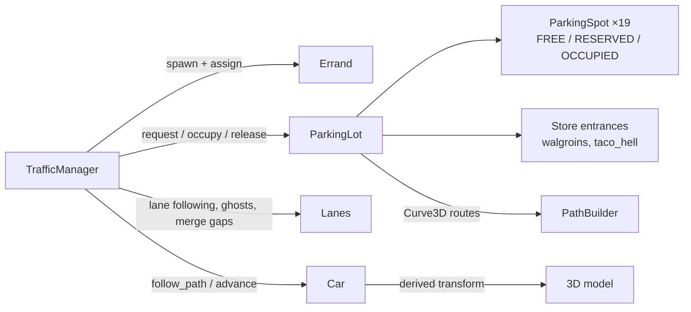
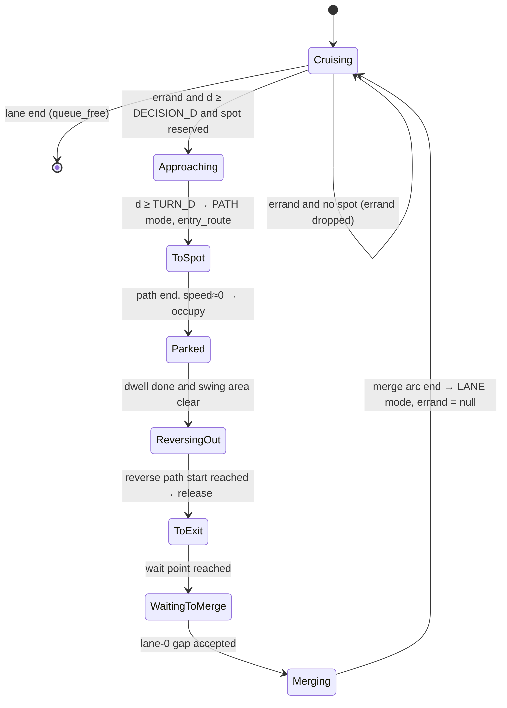

# Errands and Parking Plan

Plan for cars that leave the stroad, park at Walgroins or Taco Hell, wait, and drive away again. It describes the current code (`car.gd`, `traffic_manager.gd`, `main.tscn`) as of this writing.

## Goals

- Some spawned cars have an **errand**. Cars without one keep driving through, as they do today.
- An errand car turns into the lot, **reserves a free suitable stall**, drives to it, parks, waits, reverses out, and merges back into traffic.
- A **parking registry** tracks each stall as `FREE`, `RESERVED`, or `OCCUPIED`.
- Lot traffic should affect the stroad: turning cars slow the cars behind them, and cars waiting to merge sit across the sidewalk. This supports the game's satire.

Non-goals for this pass: left turns across oncoming traffic, lane changes, drivers getting out and walking, and more lots or driveways. These are listed under [Deferred](#deferred).

## What carries over from TRAFFIC_SIMULATION.md

| Keep                                                                                    | Drop for now                                                                 |
| --------------------------------------------------------------------------------------- | ---------------------------------------------------------------------------- |
| Authoritative state is a path plus scalar distance; the 3D transform is derived from it | Full directed lane graph and A* routing. There is one road and one driveway. |
| Stops and destinations act as virtual zero-speed obstacles                              | Signals, conflict zones, intersection reservations                           |
| Trip and Stop concepts, here reduced to one `Errand`                                    | Simulation LOD, fixed-rate tick with interpolation                           |
| Route, driver, and presentation stay separate                                           | Lane changes (Phase 4 of that doc)                                           |

When a second lot or driveway appears, upgrade the hard-coded lot routes below into a small waypoint graph. Until then, a graph would be dead weight.

## Current state (facts)

- `traffic_manager.gd` creates 4 straight lanes in `_setup_lanes()`. Cars spawn at `lane_distance = 0` and `queue_free()` at `lane.length` (140 m). Car following happens in `_update_lane_traffic()` and uses `lane.cars` sorted by distance.
- `car.gd` places a car analytically with `x = start_x + direction * lane_distance`, `z = lane_z`, and `rotation.y = 0 or PI`. The model faces local **+X**.
- `Car` is an `Area3D`. `body_entered` and `_check_player_overlap()` kill Mats on any contact, whether or not the car is moving.
- Lot geometry in `main.tscn`, using world XZ coordinates where −Z is north, away from the camera:

| Feature                       | Location                                                                                    |
| ----------------------------- | ------------------------------------------------------------------------------------------- |
| Stroad asphalt                | x −60..60, z −7.5..7.5                                                                      |
| North sidewalk                | z −10.7..−7.5, with a single curb cut (`DrivewayApron`) at **x 7..15**                      |
| Walgroins lot asphalt         | x −29..23, z −32..−10.7                                                                     |
| Taco Hell lot asphalt         | x 22..48, z −32..−10.7. Continuous with the Walgroins lot, so there is one shared driveway. |
| North stall row               | stripes at z −28.5, x −20..16 step 4 → **9 stalls**, centers x −18..14                      |
| South stall row               | stripes at z −14.5, x −20..4 → **6 stalls**, centers x −18..2                               |
| Taco stall row                | stripes at z −14.5, x 26..42 → **4 stalls**, centers x 28..40                               |
| Aisle                         | z −26.25..−16.75, center z ≈ −21.5                                                          |
| Walgroins door                | ≈ (−3, −32)                                                                                 |
| Taco Hell door (arch portico) | ≈ (31.5, −27.8)                                                                             |

Stalls are 4 m wide and 4.5 m deep. Pickups (5.0 m) stick into the aisle a little; that is acceptable.

**Only normal cars park:** `SEDAN`, `SUV`, `TAXI`, `PICKUP`. Buses and delivery trucks (`BUS`, `TRUCK`) never get errands, are never seeded into stalls, and always drive through. One helper is the single source of truth: `Car.can_park() -> bool`.

## Phase 0: switch to right-hand traffic (decided)

`_setup_lanes()` currently puts the **eastbound** lanes at z −5.6 and −1.9, on the north side. A car heading +X has its right side at +Z, so that is left-hand driving. Cars drive on the right in this game. The lots are on the north side, so the lot is reached by a **right turn in and right turn out** from the westbound curb lane. That is the simplest maneuver, so it is built first.

Change: swap directions so that lanes 0 and 1 (z −5.6, −1.9) are westbound (`direction −1`, `start_x 70`), and lanes 2 and 3 (z 1.9, 5.6) are eastbound (`direction +1`, `start_x −70`). Keep the outer and inner speed bands. All coordinates below assume this change.

Lane projection, which is used throughout:

```text
lane_distance(x) = (x - lane.start_x) * lane.direction      # lane 0: d = 70 - x
```

## Site routes (after Phase 0)

```text
z
-32   ┌──── Walgroins (door -3,-32) ────┐          ┌── Taco Hell (door 31.5,-27.8) ──┐
-28.5 │ N row  ▮▮▮▮▮▮▮▮▮  x=-18..14 nose→N           (building)                     │
-23   │ ◄──────────── aisle lane WB (heading -X) ─────────────────────────────────│
-20   │ ────────────► aisle lane EB (heading +X) ─────────────────────────────────►│
-14.5 │ S row  ▮▮▮▮▮▮  x=-18..2 nose→S                 Taco row ▮▮▮▮ x=28..40 nose→S │
-10.7 └──────────────────────────── exit x=9 ▼ ▲ entry x=13 ───────────────────────┘
-9.6                                  wait ●   ● turn-in end
-7.5  ═════ curb ══════════════════════╡ apron x 7..15 ╞══════════════════════════════
-5.6  ◄── lane 0  WB outer     merge arc ends x=5   turn-in arc starts x=17 ◄──
-1.9  ◄── lane 1  WB inner
 1.9  ──► lane 2  EB inner
 5.6  ──► lane 3  EB outer
```

| Route piece    | Geometry                                                                                                               |
| -------------- | ---------------------------------------------------------------------------------------------------------------------- |
| Turn-in arc    | Right turn, R 4: from (17, −5.6) heading −X to (13, −9.6) heading −Z. Starts at lane 0 `d = 53`.                       |
| Entry lane     | x = 13, heading −Z, up to the aisle                                                                                    |
| Aisle lanes    | z −23 heading −X (west), z −20 heading +X (east). Two-way with right-hand lanes, so cars never meet head-on.           |
| Stall approach | Corner at (stall.x, aisle lane z), then a straight run to the stall center                                             |
| Exit lane      | x = 9, heading +Z, to the **wait point** (9, −9.6). This is on the sidewalk, which is how stroad drivers really do it. |
| Merge arc      | Right turn, R 4: from (9, −9.6) heading +Z to (5, −5.6) heading −X. Ends at lane 0 `d = 65`.                           |

The direction of travel in the aisle depends on which side of the driveway the stall is on:

| Stall                           | Enter via            | Park nose          | Reverse-out ends facing | Exit via                        |
| ------------------------------- | -------------------- | ------------------ | ----------------------- | ------------------------------- |
| x < 13 (N and S rows)           | WB aisle lane, z −23 | N row −Z, S row +Z | east (+X), on z −20     | EB lane → right turn into x = 9 |
| x ≥ 13 (N row x = 14, Taco row) | EB aisle lane, z −20 | N row −Z, Taco +Z  | west (−X), on z −23     | WB lane → left turn into x = 9  |

## Architecture



Responsibilities follow the existing split, where the manager decides and the car integrates:

| Unit                                                       | Owns                                                                                                          | Does not own                   |
| ---------------------------------------------------------- | ------------------------------------------------------------------------------------------------------------- | ------------------------------ |
| `Errand` (RefCounted)                                      | `destination: StringName`, `dwell_time: float`                                                                | Spot choice, routing           |
| `ParkingSpot` (RefCounted)                                 | `id`, `transform` (parked pose), `serves: Array[StringName]`, `state`, `car`                                  | Selection policy               |
| `ParkingLot` (Node3D, created by `TrafficManager` in code) | Stall rows, store entrances, spot registry, spot selection, reservations, building routes for this lot        | Car motion, lane traffic       |
| `PathBuilder` (static funcs)                               | Waypoints → filleted `Curve3D`                                                                                | Anything stateful              |
| `Car`                                                      | Motion mode (`LANE` / `PATH`), path, distance, speed, `state`, `errand`, `spot`                               | Decisions involving other cars |
| `TrafficManager`                                           | Spawning, errand assignment, all state transitions, lane following, lot conflict checks, merge gap acceptance | Stall geometry                 |

## Errand (task) system

```gdscript
class_name Errand extends RefCounted
var destination: StringName   # &"walgroins", &"taco_hell"
var dwell_time: float         # seconds parked
```

- `Car.errand == null` means the car drives through, which is today's behavior.
- Errands are assigned at spawn, and **only on lane 0** (WB outer), because that is the only lane that can turn right into the lot. Only cars where `can_park()` is true get errands; buses and delivery trucks never do.
- Starting probabilities: `P(errand) = 0.3` on lane 0; destination weights `walgroins 0.6, taco_hell 0.4`; dwell `walgroins 20–45 s`, `taco_hell 15–30 s`.
- Pre-populated cars (`_pre_populate_traffic`) get an errand only if they spawn before the decision point.
- Multi-stop trips (Walgroins then Taco Hell, driving within the lot) would change this to `Array[Errand]`. That is not needed yet.

## Parking spot system

### Data and invariants

```gdscript
class_name ParkingSpot extends RefCounted
enum State { FREE, RESERVED, OCCUPIED }
var id: int
var transform: Transform3D        # parked pose; the car's local +X points along the nose
var serves: Array[StringName]     # e.g. [&"walgroins"]
var state := State.FREE
var car: Car = null
```

Spots are generated from a row table in `parking_lot.gd`, in the same style as the lanes in `_setup_lanes()`:

```gdscript
const STALL_SPACING := 4.0
const ROWS := [
	{ "z": -28.5, "x0": -18.0, "count": 9, "nose": -1.0, "serves": &"walgroins" },  # N row, nose -Z
	{ "z": -14.5, "x0": -18.0, "count": 6, "nose":  1.0, "serves": &"walgroins" },  # S row, nose +Z
	{ "z": -14.5, "x0":  28.0, "count": 4, "nose":  1.0, "serves": &"taco_hell" },  # Taco row, nose +Z
]
const ENTRANCES := { &"walgroins": Vector3(-3, 0, -32), &"taco_hell": Vector3(31.5, 0, -27.8) }
```

- Invariants: `car != null` exactly when `state != FREE`, and a car holds at most one spot.
- Pose: nose −Z is `rotation.y = PI/2`; nose +Z is `-PI/2`.
- Risk: the rows and entrances repeat what `main.tscn` already shows (painted stripes, building positions). If a building or the stripes move in the editor, update the constants too. The debug overlay makes any mismatch visible.

### Lifecycle

| Event                                          | Transition                                                                                        | Who                                    |
| ---------------------------------------------- | ------------------------------------------------------------------------------------------------- | -------------------------------------- |
| Errand car reaches the decision point          | `FREE → RESERVED(car)`. If nothing suitable is free, the errand is dropped and the car drives by. | `ParkingLot.request_spot(car, errand)` |
| Car reaches the end of its path with speed ≈ 0 | `RESERVED → OCCUPIED`                                                                             | `ParkingLot.occupy(spot)`              |
| Reverse-out path completes                     | `OCCUPIED → FREE`                                                                                 | `ParkingLot.release(spot)`             |
| Car leaves the tree for any reason             | Whatever it held → `FREE`                                                                         | `Car.tree_exiting` → `release`         |

The `tree_exiting` hook is mandatory. Without it, a car freed while it holds a reservation leaks the stall permanently.

### Selection

Among `FREE` spots:

```text
cost(spot) = distance(spot, destination.entrance)
           + (POACH_PENALTY if errand.destination not in spot.serves)
           + randf() * JITTER
```

Pick the minimum. Tags: the Walgroins rows serve `walgroins`, and the Taco row serves `taco_hell`. When the 4 Taco stalls are full, Taco customers poach Walgroins stalls (the penalty keeps that a last resort). This is satire-friendly; set `POACH_PENALTY = INF` to disable it. The jitter keeps every car from piling into the stall nearest the door.

### Seeding

At startup, mark about 40% of stalls `OCCUPIED` with parked cars (types where `can_park()` is true only) that have random remaining dwell times. The lot then looks lived-in, and the exit flow gets exercised within the first minute.

## Movement

### Two motion modes in `Car`

- `LANE`: today's analytic placement.
- `PATH`: `path: Curve3D`, `path_distance`, and signed `speed`. A negative speed means reversing.

```text
position = path.sample_baked(path_distance)
heading  = (sample_baked(d + 0.05) - sample_baked(d - 0.05)).normalized()
rotation.y = atan2(-heading.z, heading.x)          # model faces +X
```

Reversing does not need a special case. The car keeps facing along the tangent while the distance decreases.

Straight lanes stay analytic. Turning them into `Curve3D` would unify the two modes but buys nothing on a straight road.

### PathBuilder: filleted polylines

`PathBuilder.build(points: PackedVector3Array, radius := 4.0) -> Curve3D`

- Straight segments are joined by circular fillets. Each fillet is a cubic Bézier with handle length `(4/3)·tan(θ/4)·r`, where θ is the turn angle.
- The radius is **clamped per corner** to half of each adjacent segment, so the builder never fails. Tight layouts just get tighter turns.
- Waypoints closer together than `2·r` are merged first. This handles N row stalls x = 10 and 14, which sit almost straight up the driveway, without an S-wiggle.
- `bake_interval = 0.25`.

### Routes (built by `ParkingLot`)

| Route                 | Waypoints                                                                                                                        | Traversal                     |
| --------------------- | -------------------------------------------------------------------------------------------------------------------------------- | ----------------------------- |
| `entry_route(spot)`   | turn-in start (17, −5.6) → (13, −5.6 − r) → (13, aisle_z) → (spot.x, aisle_z) → spot                                             | forward                       |
| `reverse_route(spot)` | **Built as a forward path** from (spot.x ∓ 6, exit_aisle_z) → (spot.x, exit_aisle_z) → spot, starting on the exit side's far end | from end to 0, negative speed |
| `exit_route(spot)`    | end of reverse → (9, exit_aisle_z) → wait point (9, −9.6)                                                                        | forward                       |
| `merge_route()`       | (9, −9.6) → (9, −5.6) → (5, −5.6), using the fillet from the corner                                                              | forward                       |

`aisle_z` and `exit_aisle_z` come from the table in [Site routes](#site-routes-after-phase-0). The reverse route is built backwards on purpose: its starting tangent points toward the exit, so when the car finishes reversing it faces the exit. The rear swings away from the exit, as a real driver's would.

### Car state machine



| Constant          | Value   | Notes                                       |
| ----------------- | ------- | ------------------------------------------- |
| `TURN_D` (lane 0) | 53      | x = 17                                      |
| `DECISION_D`      | 18      | x = 52; 35 m before the turn                |
| `V_TURN`          | 5 m/s   | Speed at which the car enters the arc       |
| `A_COMFORT`       | 3 m/s²  | Approach deceleration                       |
| `V_LOT`           | 4.5 m/s | Aisle speed                                 |
| `V_PARK`          | 1.5 m/s | Final 4 m into the stall, and reversing     |
| `T_MERGE_GAP`     | 3.0 s   | Minimum time gap to upstream lane-0 traffic |
| fillet `r`        | 4 m     | Also used for the turn-in and merge arcs    |

Approach braking is a virtual obstacle at the turn point. In `_update_lane_traffic`, an `Approaching` car uses

```text
target = min(desired_speed, sqrt(V_TURN² + 2·A_COMFORT·(TURN_D - d)), following_target)
```

Cars behind it slow down through the existing following code, so no new logic is needed for them.

## Lane ↔ lot interaction

### Lane ghosts (one rule for both turning in and merging)

A `PATH` mode car is kept in `lane.cars` **while its footprint overlaps the lane band plus a 1 m margin**. Its lane-relative values are projected:

```text
lane_distance = (pos.x - lane.start_x) * lane.direction
speed (for followers) = speed * heading.dot(lane forward)
```

- **Turning in:** the car stays registered from the turn point until it has cleared the lane. Its projected distance stops at about x 13 and its projected speed drops toward 0, so followers brake behind it. If the aisle backs up and the car stops halfway in, lane 0 queues behind it. That is intended stroad behavior.
- **Merging:** the car registers at the start of the arc. Its front already overlaps the lane at z −7.5, so upstream cars see it immediately. At the end of the arc it switches to `LANE` mode with `lane_distance` equal to the projection, so nothing jumps.
- `_update_lane_traffic` must not call `advance_simulation` on ghosts. The lot loop moves them, and they serve only as leads for the following model.

### Merge gap acceptance (`WaitingToMerge`)

Accept when both conditions hold:

1. No lane-0 car has `d` in `[61 - car_length - 2, 65 + 6]`. This is the merge window, from the projection at the arc start to the arc end.
2. Every upstream lane-0 car (`d < 61`) has `(61 - d) / max(speed, 0.1) > T_MERGE_GAP`.

Lane 1 is irrelevant to a right-turn merge. After merging, the car accelerates from about 5 m/s, and the cars behind brake for it.

## Lot traffic conflicts

There are only a few lot cars, so O(n²) checks are fine.

- **Forward check:** for car A (heading signed by the sign of its speed), a blocker B is any car, in the lot or a ghost, with `0 < forward < lookahead` and `|lateral| < (wA + wB)/2 + 0.3` in A's frame. `lookahead = max(4, v²/(2·BRAKE) + 3)`. A blocker sets A's target speed to 0, the same as a virtual obstacle.
- **Reverse start:** a `Parked` car may begin reversing only if no moving car is within 8 m along the aisle on either side of `spot.x`.
- **Priority** when two cars block each other: `ToSpot > ToExit > ReversingOut`. The lower-priority car waits.
- **Watchdog:** if two cars block each other for more than 4 s at equal priority, the one with the higher instance ID ignores the other for 1.5 s. Log every time this fires; frequent firing means a route geometry bug.
- The entry (x 13) and exit (x 9) lanes are 4 m apart, and the turn-in and merge arcs do not overlap, so the driveway itself needs no arbitration.

## Mats interaction (decided)

Whether a car kills or blocks Mats depends only on its speed, with one shared cutoff, so every car is exactly one of the two. The rule applies to every car, not just parked ones:

| Car | Kills Mats | Blocks Mats |
|---|---|---|
| Moving: `abs(speed) > 0.1` m/s | yes | no |
| Stopped: `abs(speed) <= 0.1` m/s (parked, waiting to merge, stuck in a queue) | no | yes |

There is deliberately no in-between band. A band would allow a car that moves slowly while solid but not lethal, and a body teleported by its parent's transform would clip into Mats instead of pushing him.

Implementation, entirely in `.gd` files:

- `car.gd` creates an `AnimatableBody3D` child named `Blocker` in `_ready()`, with `sync_to_physics = true`. It uses the same box as the kill area from `_update_dimensions()`, plus 0.1 m on every side. An `AnimatableBody3D` pushes a `CharacterBody3D` correctly when a solid car creeps below the cutoff; a `StaticBody3D` would teleport into him. Because the blocker is slightly larger than the kill area, Mats resting against the side or back of a stopped car is outside the kill area when the car drives off. If he stands in front of it, he dies when it moves, as intended.
- The blocker is on **physics layer 3** while the car is stopped, and on no layer while it moves. Use `set_deferred("collision_layer", …)`, because the switch happens during the physics step. Layer 3 keeps the car `Area3D`s (mask 1) from reporting each other's blockers as bodies every frame.
- `mats.gd` `_ready()` adds `set_collision_mask_value(3, true)`, so `mats.tscn` stays untouched.
- `_check_hit()` returns early unless the car is moving.
- Mats' `step_height` is 0.3 and the lowest car body is 1.4 m tall, so he cannot step onto a car. [INFERENCE] His hop probably can't clear a roof either; check this in Phase 1.
- Turning, reversing, and waiting cars all cross the sidewalk band (z −10.7..−7.5). A car waiting to merge is a wall across the sidewalk, and it becomes lethal the moment it pulls out. That supports the game's point.

## No scene edits

Everything in this plan lives in `.gd` files: the stall rows, the store entrances, the lot node (`TrafficManager` creates it with `add_child`), the car blocker, and the debug overlay. AGENTS.md prefers this because the open editor hot-reloads scripts safely but can silently overwrite outside edits to `.tscn` files.

If editor-draggable spot markers are wanted later, the **user** adds them in the editor, or the agent edits `.tscn` files only while the editor is closed.

## Debug overlay (build in Phase 1, toggle F3)

- Spot discs colored green for `FREE`, yellow for `RESERVED`, red for `OCCUPIED`, with a `Label3D` showing the tag
- A `Label3D` above each car showing state, speed, and spot ID
- The active `Curve3D` of each `PATH` car, drawn with `ImmediateMesh`
- The ghost link from a lot car to its lane, and the merge window on lane 0 while a car is waiting
- A HUD line with counts: free/reserved/occupied, errands dropped for "lot full", watchdog firings

## Implementation phases

| Phase | Work                                                                                                                                                            | Acceptance (headless soak, see below)                                                                                                               |
| ----- | --------------------------------------------------------------------------------------------------------------------------------------------------------------- | --------------------------------------------------------------------------------------------------------------------------------------------------- |
| 0     | Flip lane directions to right-hand traffic                                                                                                                      | Westbound traffic on the north half; existing following unchanged                                                                                   |
| 1     | `ParkingSpot`, `ParkingLot` (code-defined rows), debug overlay, the kill-or-block rule for Mats, seeded parked cars that despawn in place when their dwell ends | 19 spots registered; overlay matches the stripes; stall states change as dwell timers expire; Mats walking into a parked car is stopped, not killed |
| 2     | `PathBuilder` and `Car` `PATH` mode; a debug key spawns a car at the turn-in start and drives it to a random free spot                                          | The car follows the route without gaps or heading flips and ends exactly on the spot pose                                                           |
| 3     | Errands on lane 0, decision point, approach braking, lane ghosts, reserve → park → dwell                                                                        | Followers slow down behind turning cars; no two cars ever share a spot; "lot full" drops are counted                                                |
| 4     | Reverse out, exit route, wait point, gap acceptance, merge, continue to lane end                                                                                | Every errand car eventually despawns at the lane end; no reservations leak after 10 minutes (stall states match the live cars)                      |
| 5     | Lot conflict checks, priority, watchdog                                                                                                                         | 10-minute soak with `P(errand) = 0.6`: no car stuck longer than 30 s, and watchdog firings rare and logged                                          |

Soak run (10 simulated minutes, reproducible):

```text
/Applications/Godot.app/Contents/MacOS/Godot --headless --path . --fixed-fps 60 --quit-after 36000 -- --seed=42
```

- `--fixed-fps 60` turns off real-time sync, so each frame advances exactly 1/60 s. With the default 60 physics ticks per second, that is one physics step per frame. 36000 frames is 10 minutes, and the run goes as fast as the CPU allows.
- In `_ready()`, `TrafficManager` reads `--seed=N` from `OS.get_cmdline_user_args()` and calls `seed(N)`. With no flag, play stays random. A failed check replays with the same traffic by passing the same seed.
- `TrafficManager._exit_tree()` prints the stats line: spot counts, errands completed and dropped, longest stuck time, watchdog firings, and leaked reservations (stall states vs live cars).

## Deferred

- **Left turns in and out** for eastbound traffic, across both westbound lanes. This needs a waiting position in lane 2 (the stroad has no turn lane, so the car blocks traffic), gap acceptance against lanes 0 and 1, and a left-out merge. It is very much on theme; do it next.
- **Lane changes**, so errand cars spawned in lane 1 can move to lane 0 (Phase 4 of TRAFFIC_SIMULATION.md).
- **Drivers get out and walk** to the store entrance and back (the README's "person gets out" idea). The car stays `Parked` until its pedestrian returns.
- **Multi-stop errands** (`Array[Errand]`), including moving between stores inside the lot.
- **A second driveway or lot:** promote the hard-coded routes to a waypoint graph with Dijkstra.
- **Stall size classes**, a Taco Hell drive-thru lane, and a loading zone where delivery trucks stop (they don't use stalls).
