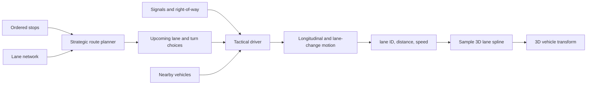

# Traffic Simulation Design

## Recommendation

Model traffic as a **logical lane network** that is mostly independent of the 3D world. Keep its topology 2D-like, but embed every lane in 3D.

The core vehicle location should be:

```text
lane ID + longitudinal distance along the lane
```

The simulation uses lane IDs, distances, connections, signals, and right-of-way. The renderer converts a vehicle's lane and distance into a 3D position and rotation by sampling a spline.

This is simpler and more reliable than asking physics-driven cars to discover roads, intersections, and traffic laws from 3D geometry.



## System Layers

### 1. Road and lane data

Represent individual lanes rather than only road centerlines.

A lane needs roughly:

```text
Lane
  id
  road_id
  direction
  length
  speed_limit
  vehicle_classes
  centerline_3d
  left_neighbor
  right_neighbor
  outgoing_connections[]
  stop_line_distance
```

A connection describes a legal movement between lanes:

```text
LaneConnection
  from_lane
  to_lane
  movement: straight | left | right | merge | u_turn
  path_3d
  priority_rule
  controlling_signal
  conflict_zones[]
```

Intersections should use explicit connections instead of being open areas where cars improvise. This supports:

- Turn restrictions
- Dedicated turn lanes
- One-way streets
- Merges and lane drops
- Traffic signals
- Stop and yield signs
- Bridges and tunnels
- Vehicle-class restrictions

### 2. Strategic route planning

Each driver receives an ordered itinerary:

```text
Depot -> Store -> School -> Home
```

For each current destination:

1. Snap the destination to a lane or designated stopping area.
2. Find a route through the lane graph.
3. Convert the route into an ordered sequence of lanes and connections.
4. Advance to the next stop after arrival.
5. Replan only when necessary.

A* is sufficient initially. Edge cost can begin as travel time:

$$
\text{cost} = \frac{\text{lane length}}{\text{speed limit}} + \text{turn penalty}
$$

Possible later additions:

- Estimated congestion
- Left-turn penalties
- Toll or road-class preferences
- Vehicle restrictions
- Temporary closures
- Driver-specific preferences

Do not run pathfinding every simulation frame. Cache routes and replan when the destination, road availability, or route deviation changes.

### 3. Tactical driving

The route says where a driver intends to go. A separate tactical controller decides what the driver can safely do now.

A practical state machine could include:

```text
Cruising
Following vehicle
Preparing lane change
Changing lane
Approaching controlled intersection
Waiting at stop line
Traversing intersection
Yielding
Arriving at stop
Parked or loading
Recovering or replanning
```

Each update examines only local information:

- Lead vehicle and gap
- Target-lane availability
- Distance to the stop line
- Current traffic-signal phase
- Required intersection movement
- Conflicting vehicles or reserved intersection space
- Desired lane for the upcoming turn

Keep route planning and tactical driving separate. A route may instruct a left turn, while the tactical controller decides to wait, change lanes early, or replan if the turn becomes unavailable.

### 4. Vehicle motion and 3D presentation

Start with constrained kinematic movement rather than full rigid-body vehicle physics.

Authoritative simulation state:

```text
lane_id
lane_distance
speed
acceleration
lane_change_progress
current_connection
```

Derived rendering state:

```text
position = lane_spline.position_at(lane_distance)
forward  = lane_spline.tangent_at(lane_distance)
up       = road_surface_normal
rotation = orientation(forward, up)
```

During a lane change, blend between the source and target lane splines. During a turn, follow the connection's spline through the intersection.

Use physics for exceptional interactions, such as collisions, player impacts, and wrecks—not for routine traffic navigation.

## 2D Logic and 3D Geometry

Use a **2D logical topology with 3D geometry**.

A purely 2D simulation works when all roads are flat and never overlap. It becomes ambiguous with:

- Bridges
- Tunnels
- Multilevel interchanges
- Parking structures
- Steep roads
- Ramps passing over other lanes

The lane graph avoids this ambiguity because connectivity is explicit. Two splines can cross visually without being connected.

| Concern                     | Representation                         |
| --------------------------- | -------------------------------------- |
| Route connectivity          | Directed lane graph                    |
| Route cost and traffic laws | Graph metadata                         |
| Vehicle progress            | Lane ID plus scalar distance           |
| Collision ordering          | One-dimensional order within each lane |
| Intersections               | Connections and conflict zones         |
| Elevation and banking       | 3D lane spline                         |
| Vehicle visuals             | Sampled 3D transform                   |
| Exceptional collisions      | 3D physics                             |

An XZ projection can still provide broad-phase spatial searches, but lane identity should determine whether two vehicles interact.

## Traffic Lights and Right-of-Way

Treat each intersection movement as a resource, for example:

```text
Northbound straight
Northbound left
Southbound straight
Southbound left
Eastbound straight
Eastbound left
Westbound straight
Westbound left
```

Each movement occupies one or more conflict zones. Two movements may proceed simultaneously only when their conflict-zone sets do not overlap.

A traffic light grants movements according to phases:

```text
Phase A: north/south straight and right
Phase B: north/south protected left
Phase C: east/west straight and right
Phase D: east/west protected left
```

A vehicle may enter an intersection when:

1. Its movement is permitted by the signal or priority rule.
2. Conflicting space is available.
3. There is enough downstream space to clear the intersection.

The downstream-space check prevents cars from entering on green and blocking the junction.

For unsignalized intersections:

- **Stop:** reach the line, stop for a minimum interval, then request entry.
- **Yield:** proceed if no higher-priority conflicting movement will arrive within a safe time window.
- **Priority road:** lower-priority approaches wait.
- **All-way stop:** order by arrival, then use deterministic tie-breaking.

An intersection reservation system is generally easier and more deterministic than reproducing human negotiation through collision avoidance alone.

## Following and Stopping

Use a car-following model that produces desired acceleration based on:

- Current speed
- Desired speed
- Gap to the lead vehicle
- Relative speed
- Distance to a virtual obstacle

Represent stop lines, red lights, occupied intersections, and route destinations as **virtual lead vehicles with zero speed**. The same braking logic can then handle most stopping behavior.

A simple initial controller:

```text
desired_speed = min(
    speed_limit,
    curve_safe_speed,
    lead_vehicle_safe_speed,
    stop_line_safe_speed
)

acceleration = clamp(
    response_gain * (desired_speed - current_speed),
    max_braking,
    max_acceleration
)
```

An established model such as the Intelligent Driver Model can replace this later if smoother following is needed.

## Lane Changing

Separate mandatory and discretionary lane changes.

Mandatory changes include:

- Moving into a turn lane
- Avoiding a lane ending
- Preparing for a merge
- Reaching a stop on a particular side

Discretionary changes include:

- Passing a slower vehicle
- Avoiding a congested lane
- Preferring a faster lane

A lane change should require:

- A legal adjacent lane
- Sufficient front and rear gaps
- No incompatible intersection movement in the immediate horizon
- A worthwhile or route-required reason
- A cooldown to prevent oscillation

Route planning should look ahead far enough to assign the correct lane before an intersection. Otherwise vehicles will attempt impossible last-second changes.

## Ordered Stops

Model a trip as explicit tasks rather than only destination coordinates:

```text
Trip
  stops[]
  current_stop_index

Stop
  target_zone
  acceptable_approach_lanes[]
  dwell_duration
  arrival_radius
  activity_type
```

A stop is complete when the vehicle:

1. Reaches an acceptable stopping lane or parking space.
2. Enters the arrival zone.
3. Slows below the arrival threshold.
4. Remains for the required dwell duration.

The itinerary then advances to the next stop. This supports deliveries, buses, taxis, errands, and service vehicles without changing the driving system.

## Simulation and Rendering Interoperability

Use one authoritative simulation state. Do not let the 3D transform become the source of truth during ordinary driving.

```text
Authoritative simulation state:
  lane_id = 1042
  lane_distance = 37.6 m
  speed = 8.2 m/s

Derived presentation state:
  world_position
  world_rotation
  wheel_rotation
  steering_angle
  suspension_pose
```

Run traffic on a fixed timestep, such as 10–20 updates per second, and interpolate visuals at the rendering frame rate.

```text
simulation tick N -------- simulation tick N+1
           render frames interpolate between them
```

Benefits include:

- Deterministic behavior
- Stable path following
- Easier save and load
- Easier replay and debugging
- Less sensitivity to rendering frame rate
- Potential server-side or background simulation

## Spatial Organization

Avoid checking every vehicle against every other vehicle. Maintain:

- Vehicles ordered by distance on each lane
- Occupancy for lane connections
- Reservation state for intersection conflict zones
- A spatial grid for exceptional nearby interactions

Most following queries become “which vehicle is immediately ahead on this lane?” instead of general 3D collision searches.

At lane boundaries, include vehicles on the next connection or lane in the lookahead query.

## Simulation Level of Detail

Use multiple simulation fidelities if the world contains many vehicles.

| Distance or relevance | Simulation fidelity                                   |
| --------------------- | ----------------------------------------------------- |
| Near the player       | Full tactical driving and 3D collision awareness      |
| Visible middle range  | Lane following, signals, following, and lane changes  |
| Far away              | Coarse graph progress and intersection capacity       |
| Irrelevant or off-map | Scheduled trip progress or despawned population state |

Promoting a vehicle to higher fidelity means reconstructing a valid lane position and local traffic context. Demotion stores route progress rather than relying on the vehicle's 3D transform.

## Implementation Sequence

### Phase 1: One-lane loop

- Author a 3D lane spline.
- Place vehicles by lane ID and distance.
- Advance them kinematically.
- Sample the spline into 3D transforms.
- Maintain safe following distance.

This proves the logical-to-3D bridge.

### Phase 2: Directed lane graph

- Connect several lanes.
- Add route planning.
- Traverse connection splines.
- Add ordered destinations.

### Phase 3: Controlled intersection

- Add stop lines.
- Add signal phases.
- Create virtual obstacles for red lights.
- Check downstream space.
- Model explicit intersection movements.

### Phase 4: Lane selection

- Add adjacent-lane relationships.
- Make mandatory lane changes for turns.
- Add gap acceptance.
- Blend lane-change trajectories.

### Phase 5: Right-of-way

- Add yield signs.
- Add stop signs.
- Define conflict zones.
- Add intersection reservations.

### Phase 6: Scale and polish

- Add spatial partitioning.
- Add simulation level of detail.
- Make route costs congestion-aware.
- Add driver variation.
- Improve animation and wheel steering.
- Add debugging visualization and replay.

## Debugging Tools

Build these early:

- Lane spline and direction display
- Lane and connection IDs
- Planned route highlighting
- Current tactical state above each vehicle
- Desired and actual speed
- Current braking target
- Lead-vehicle link
- Traffic-light movement permissions
- Conflict-zone occupancy
- Reason a vehicle is waiting
- Route-replanning reason

Traffic bugs otherwise appear as “the car stopped for no reason,” while the real cause could be a stale reservation, missing lane connection, blocked downstream lane, or incorrect signal association.

## Architectural Boundaries

Keep these concepts separate:

- **Trip:** the ordered places the driver wants to visit
- **Route:** the lanes selected to reach the next place
- **Maneuver:** the upcoming turn, merge, or lane change
- **Driver:** decisions about speed, gaps, and right-of-way
- **Vehicle:** physical capabilities and current motion
- **Presentation:** the 3D model and animation

The recommended starting point is **lane-coordinate simulation with 3D spline embedding**: not a completely separate flat world, and not fully physics-driven 3D traffic.
