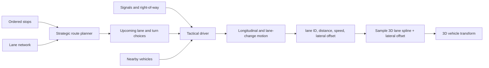

# Traffic Simulation Design

## Recommendation

Model traffic as a **logical lane network** that is mostly independent of the 3D world. Keep its topology 2D-like, but embed every lane in 3D.

The core vehicle location should be:

```text
lane ID + longitudinal distance along the lane
```

The simulation uses lane IDs, distances, connections, signals, and right-of-way. The renderer converts a vehicle's lane and distance into a 3D position and rotation by sampling a spline.

This is simpler and more reliable than asking physics-driven cars to discover roads, intersections, and traffic laws from 3D geometry.



## System Layers

### 1. Road and lane data

Represent individual lanes rather than only road centerlines.

A lane needs roughly:

```text
Lane
  id
  road_id
  direction
  length
  speed_limit
  vehicle_classes
  centerline_3d
  left_neighbor
  right_neighbor
  outgoing_connections[]
  stop_line_distance
```

A connection describes a legal movement between lanes:

```text
LaneConnection
  from_lane
  to_lane
  movement: straight | left | right | merge | u_turn
  path_3d
  priority_rule
  controlling_signal
  conflict_zones[]
```

Intersections use explicit connections instead of open areas where cars improvise. This supports:

- Turn restrictions
- Dedicated turn lanes
- One-way streets
- Merges and lane drops
- Traffic signals
- Stop and yield signs
- Bridges and tunnels
- Vehicle-class restrictions

### 2. Strategic route planning

Each driver receives an ordered itinerary:

```text
Depot -> Store -> School -> Home
```

For each current destination:

1. Snap the destination to a lane or designated stopping area.
2. Find a route through the lane graph.
3. Convert the route into an ordered sequence of lanes and connections.
4. Advance to the next stop after arrival.
5. Replan only when necessary.

A* is sufficient initially. Edge cost can begin as travel time:

$$
\text{cost} = \frac{\text{lane length}}{\text{speed limit}} + \text{turn penalty}
$$

Possible later additions:

- Estimated congestion
- Left-turn penalties
- Toll or road-class preferences
- Vehicle restrictions
- Temporary closures
- Driver-specific preferences

Do not run pathfinding every simulation frame. Cache routes and replan when the destination, road availability, or route deviation changes.

### 3. Tactical driving and states

The route says where a driver intends to go. A separate tactical controller decides what the driver can safely do now.

Vehicle states (`Car.State`):

```text
CRUISING          - Stroad lane following with car-following and bounded lateral wander
APPROACHING       - Centering and preparing to enter parking lot entrance path
TO_SPOT           - Navigating lot aisles to reserved parking stall
PARKED            - Dwelling in stall with engine off / hazard idle
REVERSING_OUT     - Backing out of stall into aisle before forward departure
TO_EXIT           - Following aisle path to lot apron / merge point
WAITING_TO_MERGE  - Yielding at stroad entry apron for a gap in mainline traffic
MERGING           - Blending from lot exit path into target stroad lane
DRIVE_THRU        - Following queued drive-thru lane and order/pickup windows
SHORTCUT          - Traversing authored cross-lot grass corridor to adjacent site
PULLED_OVER       - Traffic stop: pulling onto, sitting on, or leaving the curb-lane shoulder
```

Each update examines only local information:

- Lead vehicle and gap
- Target-lane availability
- Distance to the stop line
- Current traffic-signal phase
- Required intersection movement
- Conflicting vehicles or reserved intersection space
- Desired lane for the upcoming turn

Keep route planning and tactical driving separate. A route may instruct a left turn, while the tactical controller decides to wait, change lanes early, or replan if the turn becomes unavailable.

### 4. Vehicle motion and 3D presentation

Kinematic movement drives standard traffic rather than full rigid-body vehicle physics.

Authoritative simulation state:

```text
lane_id                  - Current lane index (or -1 if path-following)
lane_distance            - Distance along current lane centerline
speed                    - Longitudinal speed (m/s)
acceleration             - Longitudinal acceleration rate
current_lateral_z        - Current lateral world coordinate across lane
lane_wander_offset       - Bounded lateral displacement from lane center
is_changing_lanes        - True while executing lane-change transition
lane_change_progress     - Normalized [0, 1] interpolation progress
lane_change_from_z       - Starting lateral coordinate for lane change
lane_change_to_z         - Target lateral coordinate for lane change
current_connection       - Active lane connection or intersection path
state                    - Discrete Car.State
```

Derived presentation state:

```text
position = lane_spline.position_at(lane_distance) + lateral_offset_vector
forward  = lane_spline.tangent_at(lane_distance) + derived_yaw_from_lateral_rate
up       = road_surface_normal
rotation = orientation(forward, up)
```

During a lane change, blend smoothly from `lane_change_from_z` (preserving current lateral position without snapping) to target `lane_change_to_z`. During a turn or lot movement, follow the authored spline path.

## Lateral Offset and Lane Wandering

Vehicles naturally wander laterally within their lane to appear organic and non-robotic without violating lane boundaries:

- **Offset Bounds:** Each vehicle calculates its maximum lateral wander:
  $$ \text{max\_offset} = \max\left(0, \frac{\text{LANE\_WIDTH}}{2} - \frac{\text{car\_width}}{2} - \text{SIDE\_CLEARANCE}\right) $$
  where `LANE_WIDTH = 3.75 m` and `SIDE_CLEARANCE = 0.20 m`.
- **Vehicle Variation:** Narrower vehicles (hatchbacks, sedans) have wider allowable wander ranges (e.g. ±0.725–0.775 m), while wider vehicles (buses, shipping trucks at 2.4–2.5 m width) have tightly restricted wander (±0.425–0.475 m).
- **Target Selection:** Wander targets are sampled on an interval of 2.5–7.0 seconds, transitioning smoothly over 1.5–4.0 seconds using smoothstep interpolation.
- **Visual Yaw:** Lateral velocity applies a subtle yaw adjustment so the car body tilts slightly into the drift.
- **Lane Change Continuity:** Lane changes begin at `current_lateral_z` rather than snapping to the lane centerline, ensuring continuous visual trajectories regardless of initial wander. Wandering is paused during lane changes and resumes once settled in the destination lane.
- **Transitions:** Cars center (`lane_wander_offset = 0`) before entering parking routes (`APPROACHING`) and re-initialize wandering when returning to `CRUISING` on the stroad.

## Risky Passes and Reckless Driving

To create organic traffic friction, a small fraction of drivers exhibit aggressive behavior:

- **Driver Trait:** A stable `risk_tolerance` is sampled once per vehicle during setup. Drivers with `risk_tolerance >= 0.8` (~1.5% of passenger vehicles) are reckless. Buses, shipping trucks, and delivery vehicles are never reckless.
- **Pass Evaluation:** When blocked behind a slower vehicle, reckless drivers evaluate lane-change opportunities using an explicit risk mode in `_can_swerve_to_lane()`:
  - Normal drivers require safe longitudinal margins: $\ge 16\text{ m}$ forward gap, $\ge 20\text{ m}$ rear gap.
  - Risk mode permits marginal gaps: $\ge 7.5\text{ m}$ forward gap, $\ge 12\text{ m}$ rear gap.
  - Sub-marginal gaps ($< 7.5\text{ m}$ forward or $< 4.5\text{ m}$ rear) are rejected unconditionally.
- **Invariants:** Risk mode never relaxes core safety invariants: wrong-direction lanes, lane ends, turn-in zones, existing overlaps, and simultaneous adjacent maneuvers remain strictly prohibited.
- **Commit Window:** Once initiated, the reckless driver enters a brief `risk_commit_active` window (1.0 s) with normal lane-change cooldowns, preventing rapid oscillating swerves.

## Police Traffic Stops

Police can pull cars over on the curb lanes (0 and 3). `TrafficStop` (`traffic/traffic_stop.gd`) owns one stop; `TrafficManager.traffic_stops` runs them before lane updates.

- **Patrol duty:** A police SUV spawned on the stroad rolls patrol duty (`PATROL_PROBABILITY`, 75%) instead of an errand. Patrol cars drift toward the curb lane and drive dark (`Car.set_siren`).
- **Pursuit:** A patrol car in a curb lane lights up (lights + wail) behind the nearest car ahead within 60 m, if that car is cruising errand-free, is not a bus/shipping truck/police, and a stop site exists ahead. The police speed up to close in; the pursuit aborts after 30 s or if either car leaves the lane.
- **Stop site:** When the police are within 14 m, the stopped car picks the first site past its braking distance where both cars fit with their outer side at $|z| \in [13.15, 13.4]$ m, straddling the road edge (11.25 m) and the sidewalk curb (13.0 m). Sites stay inside the tunnels, off each lot's turn-in → driveway → merge span (10 m before, 12 m after), and clear of anything standing in the shoulder box (a physics query catches lamps, poles, hydrants, signs, and pedestrians).
- **Pulling over:** Both cars enter `PULLED_OVER` and brake to their stop points, police 2.5 m behind. Within 30 m of its stop point each car eases onto the shoulder through `Car.lateral_bias` (a critically damped spring on top of lane wander), so it doesn't ride the shoulder across driveways. Wheels past the curb lift and roll the body.
- **Dwell & departure:** They sit 12–22 s with police lights flashing silently. The stopped car signals, waits until nothing is alongside and the nearest car behind is far enough back for its speed (or has stopped), launches gently, steers back, and rejoins as `CRUISING`; once it is 12 m away the police go dark and leave the same way. After 3 s of signaling, traffic behind that can still stop yields to the departing car. Each patrol car makes one stop.
- **Passing traffic:** A pulled-over car with $|\text{lateral\_bias}| \ge 2$ m no longer counts as a lane leader (unless it is pulling out, see above). Cars behind slow toward 9 m/s, swerve 1 m away from the shoulder in-lane within 35 m, and eligible drivers move over a lane within 60 m. No car changes into a lane just before a stop. A car on the shoulder follows nobody; a stop participant still mid-transition remains a normal leader.

## Bus Stops

Bus stop poles (`props/bus_stop.tscn`, placed by `world/bus_stops.tscn`) are in the `bus_stops` group. `TrafficManager._collect_bus_stops()` assigns each to the curb lane on its side (`Lane.bus_stops`, pole lane distances). Two serve westbound Lane 0 (x = 52, −88) and two serve eastbound Lane 3 (x = −75, 108). All four sit clear of lot turn-ins and merges.

- **Pulling in:** A `BusCar` in a curb lane starts approaching the next pole once it is within comfortable braking distance (2 m/s²), signals right, and brakes so its front door stops at the pole. A stop that would need more than 3.5 m/s², or that another curb stop already occupies, is skipped. Within 30 m it tucks toward the curb through `Car.lateral_bias`, ending with its outer side at $|z| = 12.95$ m, short of the sidewalk and the sign.
- **Dwell & departure:** It dwells 6–12 s, then signals left and pulls out under the same rules as a traffic stop (`TrafficStop.lane_clear_to_reenter`, yield request after 3 s, gentle launch, steer back once rolling).
- **Passing traffic:** Once tucked in ($|\text{lateral\_bias}| \ge 2.2$ m) the bus is beside the lane (`Car.is_beside_lane()`). Traffic slows, swerves in-lane, or moves over exactly as it does for a traffic stop. Police never pick a site overlapping a bus stop's curb zone (30 m behind to 6 m past the pole).

## Grass Shortcuts Between Lots

Eligible vehicles may bypass road traffic by taking authored shortcuts across grass between neighboring commercial lots:

- **Authored Links:** Shortcuts exist only as explicit, authored site-to-site topology (`SHORTCUT_LINKS` in `traffic/parking_lot.gd`), each drivable both ways:
  - Strip Mall `strip_mall` $\leftrightarrow$ Cramped Inn `cramped_inn` at $z = 24.8\text{ m}$, $x \in [13, 18]\text{ m}$.
  - Smell `smell` $\leftrightarrow$ Walgroins (`north` site) at $z = -30\text{ m}$, $x \in [-41, -29]\text{ m}$, north of the trees between the lots. Walgroins drivers only cut over to the gas pumps (`destination_serves`); Taco Hell stalls in the same site have no link.
  - Cramped Inn $\leftrightarrow$ Leaders (`frontage_retail` stalls of the `frontage` site), past the inn's east stalls and across the lawn under the frontage road bend at $z = 33.5\text{ m}$, $x \in [62, 74]\text{ m}$.
  - Leaders $\leftrightarrow$ Consumer Car Care across the seam where the lots adjoin ($x \approx 101\text{ m}$), and Consumer Car Care $\leftrightarrow$ Checkers across the seam at the east end of the car care pad ($x \approx 137\text{ m}$). Both are paved (`"ruts": false`) and filtered by business within the single `frontage` site.
- **Link Data:** Each link lists `waypoints` from source aisle to destination aisle (lot-side waypoints already behind the car or past the destination stall are skipped), the `grass` rectangle driven at grass speed, optional `source_serves`/`destination_serves` business filters, optional `departure_aisle_z`/`arrival_aisle_z` overrides to follow aisle traffic, and optional `"ruts": false` for paved seams.
- **Corridor Clearance:** Every source/destination stall pair must clear buildings, canopy columns, signs, trees, props, and other stalls. `ShortcutRuts` (`props/shortcut_ruts.gd`, under `world/parking.tscn`) generates dirt tire ruts along each grass corridor (between `grass_entry` and `grass_exit`) and across the verge and lawn at every sidewalk crossing.
- **Eligibility & Evaluation:** When a parked car is cleared to leave (see [Lot Occupancy and Departures](#lot-occupancy-and-departures)), an eligible car at a linked stall rolls once (`SHORTCUT_DEPARTURE_PROBABILITY`, 25%). Ineligible vehicles (buses, trucks, drive-thru patrons, or cars that already took a shortcut) and failed rolls proceed to normal road exits.
- **Reservation Lifecycle:**
  1. _Pre-reservation:_ The candidate destination stall is reserved (`ParkingSpot.State.RESERVED`) in `car.pending_destination_spot`.
  2. _Reverse-out:_ The vehicle reverses out of its stall (`State.REVERSING_OUT`) along `ParkingLot.shortcut_reverse_route()`, backing away from the shortcut into its departure aisle so the car faces along it. The source spot remains `OCCUPIED` and the destination remains `RESERVED`.
  3. _Transition to Shortcut:_ On reverse-out completion, the source spot is released to `FREE`, the destination spot is promoted to `car.spot`, and the vehicle enters `State.SHORTCUT`.
  4. _Grass Traversal:_ Follows the authored spline at reduced grass speed $V_{\text{GRASS}} = 3.5\text{ m/s}$ (compared to $V_{\text{LOT}} = 5.0\text{ m/s}$), yielding to conflicting lot traffic using swept-footprint checks.
  5. _Arrival & Dwell:_ Reaching the destination stall transitions the vehicle to `State.PARKED` with a brief dwell (4.0–8.0 s), setting `has_taken_shortcut = true` to prohibit shortcut chaining.
  6. _Normal Exit:_ After dwell, the car reverses out and departs via the destination lot's standard apron exit onto the stroad.
- **Cancellation Safety:** If aborted, cancelled, or despawned, both `spot` and `pending_destination_spot` are released immediately to prevent allocation leaks.

## Sidewalk Shortcuts Onto the Stroad

Instead of using its driveway, a departing car may jump the curb across the sidewalk:

- **Crossings:** `SIDEWALK_CROSSINGS` in `traffic/parking_lot.gd` lists clear crossing centerlines per site: `north` $x = 19.5$ (between the driveway and the Taco Hell row), `strip_mall` $x = -13$, `cramped_inn` $x \in \{31.5, 45.5\}$ (the inn also has a lawn strip behind the sidewalk, `lawn_edge_z`). Each avoids stalls, signs, poles, trees, driveways, and the player's spawn on the strip mall sidewalk ($x = 0$; cars kill on contact).
- **Evaluation:** When a parked car is cleared to leave and does not take a lot shortcut, it rolls `SIDEWALK_SHORTCUT_PROBABILITY` (15%; buses and trucks never do). `ParkingLot.sidewalk_crossing_x()` picks the nearest crossing at least `SIDEWALK_MIN_RUN` ahead of its back-out point and short of its own driveway; none means a normal exit. The choice is stored in `car.sidewalk_crossing_x` and cleared once the car is cruising.
- **Route:** After the normal reverse-out, `ParkingLot.sidewalk_exit_route()` drives along the aisle to the crossing and over the sidewalk to the curb wait point ($|z| = 13.375$). The car then gap-merges like any driveway exit: `ParkingLot.merge_x()`/`merge_path()` recognize a crossing wait point and turn into the curb lane from there.

## 2D Logic and 3D Geometry

Use a **2D logical topology with 3D geometry**.

A purely 2D simulation works when all roads are flat and never overlap. It becomes ambiguous with:

- Bridges
- Tunnels
- Multilevel interchanges
- Parking structures
- Steep roads
- Ramps passing over other lanes

The lane graph avoids this ambiguity because connectivity is explicit. Two splines can cross visually without being connected.

| Concern                     | Representation                          |
| --------------------------- | --------------------------------------- |
| Route connectivity          | Directed lane graph                     |
| Route cost and traffic laws | Graph metadata                          |
| Vehicle progress            | Lane ID plus scalar distance            |
| Lateral displacement        | Scalar wander offset within lane bounds |
| Collision ordering          | One-dimensional order within each lane  |
| Intersections               | Connections and conflict zones          |
| Elevation and banking       | 3D lane spline                          |
| Vehicle visuals             | Sampled 3D transform + lateral offset   |

## Following and Stopping

Use a car-following model that produces desired acceleration based on:

- Current speed
- Desired speed
- Gap to the lead vehicle
- Relative speed
- Distance to a virtual obstacle

Represent stop lines, red lights, occupied intersections, and route destinations as **virtual lead vehicles with zero speed**. The same braking logic can then handle most stopping behavior.

```text
desired_speed = min(
    speed_limit,
    curve_safe_speed,
    lead_vehicle_safe_speed,
    stop_line_safe_speed
)

acceleration = clamp(
    response_gain * (desired_speed - current_speed),
    max_braking,
    max_acceleration
)
```

## Ordered Stops and Errands

Model trips as explicit tasks:

```text
Trip
  stops[]
  current_stop_index

Stop
  target_zone
  acceptable_approach_lanes[]
  dwell_duration
  arrival_radius
  activity_type
```

A stop is complete when the vehicle:

1. Reaches an acceptable stopping lane or parking space.
2. Enters the arrival zone.
3. Slows below the arrival threshold.
4. Remains for the required dwell duration.

The itinerary then advances to the next stop or lot exit.

## Lot Occupancy and Departures

Parked cars have no errand timer. Lots stay semi-full and churn instead:

- **Seeding:** Each site starts 60–85% full (`SEED_FILL_MIN`/`MAX`), leaving at least one stall free.
- **Minimum stay:** A car that parks waits 3–8 s (`PARK_DWELL_MIN`/`MAX`; seeded cars 0–8 s), then considers leaving every tick.
- **Leave gate (`_may_leave`):** It backs out only while
  - at most `leave_tolerance` cars are already leaving its site (`REVERSING_OUT` → `MERGING`); each car rolls a tolerance of 0–3 when it parks, and
  - the site stays at or above `PARKING_TARGET_FILL` (50%) of its stalls once it goes, counting inbound reservations and excluding cars already leaving.
- **Inflow:** Curb lanes 0 and 3 spawn every 1.8–3.4 s and 90% of eligible cars roll an errand (`P_ERRAND`). Each arrival above the floor frees a parked car, so lot traffic tracks arrivals.
- Test fixtures set `parking_fill_floor = 0` so a lone test car can leave an otherwise empty lot.

## Jam Recovery and Car Cap

- **Stuck removal:** `TrafficManager._despawn_stalled_car()` runs every tick after lot updates. Each live car (lot and lane, counted once) accumulates `Car.stalled_time` while `!is_moving()`; it resets while moving, `PARKED`, dwelling at a drive-thru window (`dt_dwell_timer`), or in a traffic stop. Once a car passes `STUCK_DESPAWN_TIME` (30 s; `stuck_despawn_time` per instance), the longest-stalled car is despawned and every other car's `stalled_time` restarts, so the queue behind it gets a full window to pull away instead of being removed in a chain. This catches conflicts the yielding rules and deadlock watchdog cannot resolve (e.g. two head-on `SHORTCUT` cars the watchdog keeps re-firing on). Counted in `stats["stuck_despawns"]` and logged as `STUCK:` with the car's blocker.
- **Spawn cap:** `live_car_count` tracks `Car` children of the manager (all states, parked included). Lane spawning waits while it is at `MAX_LIVE_CARS` (110); a fresh game starts with ~80.
