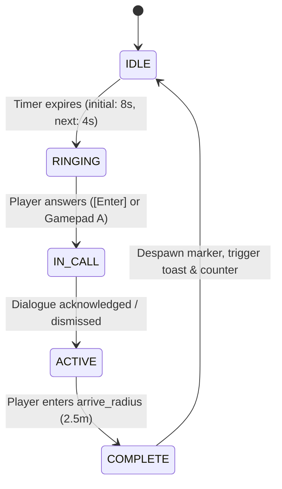
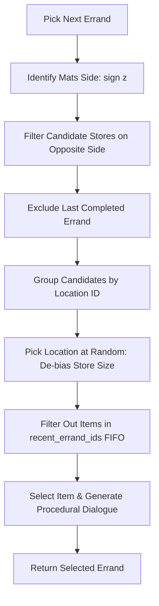

# Mats Objective System

The Mats objective system governs the primary gameplay motivation loop in Stroad Hero. Mom calls Mats on his cell phone with procedural errands, sending him to commercial destinations on the opposite side of the suburban arterial stroad.

Completing errands increments the **OBJ** counter, awards visual celebrations, and loops continuously while player traffic and physics continue uninterrupted.

---

## 1. System Architecture

The objective system is composed of data resources, a centralized manager, in-world 3D indicators, and HUD overlay widgets. It is entirely decoupled from vehicle traffic destinations (`traffic/errand.gd`).

| Component              | File                              | Type              | Role                                                                                              |
| ---------------------- | --------------------------------- | ----------------- | ------------------------------------------------------------------------------------------------- |
| **Objective Manager**  | `objectives/objective_manager.gd` | `Node`            | Central state machine, timing, errand selection algorithm, distance tracking, marker lifecycle.   |
| **Errand Resource**    | `objectives/mats_errand.gd`       | `Resource`        | Data model representing an errand (item, location, entrance node path, dialogue lines).           |
| **Objectives Data**    | `objectives/mats_objectives.json` | JSON              | External catalog of locations, door paths, item pools, and procedural dialogue templates.         |
| **World Marker**       | `objectives/objective_marker.gd`  | `Node3D`          | In-world waypoint: emissive bobbing cone, ground arrival ring, store label, completion particles. |
| **Phone Call UI**      | `ui/phone_call.gd` / `.tscn`      | `Control`         | Ringing alert, caller ID, dialogue typewriter panel, input handling (`answer_phone`).             |
| **Off-Screen Pointer** | `ui/objective_arrow.gd`           | `Control`         | Viewport-clamped HUD chevron showing direction and distance in meters when target is off-screen.  |
| **Completion Toast**   | `ui/objective_toast.gd`           | `PanelContainer`  | Center-screen toast modal with custom checkmark celebrating item collection.                      |
| **HUD Counter**        | `ui/hud.gd`                       | `CanvasLayer`     | Top-left green **OBJ** counter with increment flash and active objective description line.        |
| **Player Controller**  | `player/mats.gd`                  | `CharacterBody3D` | 3D phone model attachment, procedural arm/head phone poses, death/respawn handling.               |

### Scene Hierarchy Context

In `main.tscn`, `ObjectiveManager` sits as a direct child of `Main`:

```
Main
├── ObjectiveManager (objectives/objective_manager.gd)
├── Mats (player/mats.tscn)
├── Props (Walgroins, BoogerKingSite, TacoHell, SmellGasStation)
├── HUD (ui/hud.tscn)
│   ├── PhoneCall (ui/phone_call.tscn)
│   ├── ObjectiveArrow (ui/objective_arrow.gd)
│   └── ObjectiveToast (ui/objective_toast.gd)
└── StartScreen (ui/start_screen.tscn)
```

---

## 2. State Machine & Lifecycle

`ObjectiveManager` operates an explicit 5-state lifecycle:



### State Definitions

1. **`IDLE`**:
   - No active errand. A countdown timer (`_call_timer`) counts down in `_process()`.
   - Timer is paused if the game tree is paused or `StartScreen` is visible.
   - Default delays: `initial_call_delay = 8.0` seconds on boot; `next_call_delay = 4.0` seconds after completion.
   - In test mode (`--test-*` CLI argument), the delay is skipped and the first call starts immediately.

2. **`RINGING`**:
   - `start_call()` selects an errand via `_pick_next()`, generates dialogue, transitions state, and emits `call_started(errand)`.
   - `PhoneCall` UI displays the ringing panel with a pulsing phone icon and "[Enter] Answer" prompt.
   - `Mats` player controller switches to `PhoneMode.RINGING`: Mats pulls out his phone with his right arm to check the screen.

3. **`IN_CALL`**:
   - Triggered when the player presses `answer_phone` (`KEY_ENTER`, `KEY_KP_ENTER`, or Gamepad A).
   - Emits `call_answered(errand)`.
   - `PhoneCall` UI displays Mom's dialogue with a typewriter effect (`visible_ratio` tween).
   - If player presses `answer_phone` while the typewriter is running, it snaps immediately to 100% visible text.
   - `Mats` player controller switches to `PhoneMode.TALKING`: Mats holds the phone to his right ear, tilts his head, and subtly nods while breathing.
   - Player movement input is held still, but traffic and world physics continue. `FollowCamera` ignores `camera_left` to avoid accidental camera rotation on A-press.

4. **`ACTIVE`**:
   - Triggered when the player acknowledges the call dialogue (`dismiss_call()`).
   - Emits `objective_started(errand)`.
   - `Mats` ends the phone call animation and returns his phone to his pocket.
   - Spawns the 3D `ObjectiveMarker` above the target store's doors.
   - `HUD` reveals the objective task line (e.g. `Get cough syrup at Walgroins`).
   - `ObjectiveArrow` monitors the target position in `_process()`. If off-screen, it clamps to the screen perimeter and displays distance in meters.
   - `ObjectiveManager._physics_process()` checks horizontal Euclidean distance ($XZ$) between Mats and target door position:
     $$\text{dist}_{xz} = \sqrt{(x_{\text{mats}} - x_{\text{target}})^2 + (z_{\text{mats}} - z_{\text{target}})^2}$$
     If $\text{dist}_{xz} < \text{arrive\_radius}$ ($2.5\text{ m}$), completion is triggered.

5. **`COMPLETE`**:
   - Increments `completed_count`.
   - Spawns pop particle burst and fades out `ObjectiveMarker`.
   - Emits `objective_completed(errand, completed_count)`.
   - `ObjectiveToast` displays center-screen celebration banner ("Got the cough syrup!").
   - `HUD` flashes and increments the green **OBJ** counter.
   - Transitions immediately to `IDLE` and schedules the next call with `next_call_delay` ($4.0\text{ s}$).

---

## 3. Data Catalog & Target Resolution

Errands are specified in `objectives/mats_objectives.json` with in-code fallback to `ObjectiveManager.DEFAULT_OBJECTIVES_DATA`.

### Supported Locations

The stroad runs along the $X$-axis. North is $-Z$ and South is $+Z$. Sidewalks sit at $z \approx \pm 9.1\text{ m}$.

| Store ID      | Proper Name | Generic Name          | Stroad Side  | Scene Target Node Path                               | Fallback Coordinate $(X, Y, Z)$ | Item Pool                                                   |
| ------------- | ----------- | --------------------- | ------------ | ---------------------------------------------------- | ------------------------------- | ----------------------------------------------------------- |
| `walgroins`   | Walgroins   | the pharmacy          | North ($-Z$) | `Props/Walgroins/Building/Doors`                     | $(-3.0, 1.3, -31.35)$           | cough syrup, band-aids, potato chips, toothpaste, batteries |
| `smell`       | Smell       | the convenience store | North ($-Z$) | `Props/SmellGasStation/Store/DoorGlass`              | $(-52.5, 1.6, -31.3)$           | milk, cereal, chewing gum, beef jerky                       |
| `booger_king` | Booger King | the burger joint      | South ($+Z$) | `Props/BoogerKingSite/Building/Building/Tower/Doors` | $(-47.3, 1.3, 29.4)$            | hamburgers                                                  |
| `taco_hell`   | Taco Hell   | the taco stand        | North ($-Z$) | `Props/TacoHell/Building/MainArchPortico/Doors`      | $(31.5, 1.3, -27.75)$           | tacos, burritos, quesadillas                                |

### Dynamic Position Resolution

`ObjectiveManager.get_target_position(errand)` resolves destinations dynamically:

1. Searches for the node at `errand.target_path` in `Main`'s scene tree.
2. If found, uses its `global_position`. This guarantees that if buildings or props are moved, objectives follow automatically.
3. If the node is not found (e.g. in isolated unit tests), falls back to the exact pre-calculated world coordinates in the table above.

---

## 4. Selection Algorithm & Balancing

`ObjectiveManager._pick_next()` ensures variety, prevents repetitive loops, and maintains core stroad crossing gameplay.



### Balancing Rules

1. **The Opposite-Side Rule**:
   - Mats's current stroad side is evaluated via $\operatorname{sign}(z_{\text{mats}})$.
   - Only destinations with $\operatorname{sign}(z_{\text{target}}) \neq \operatorname{sign}(z_{\text{mats}})$ are considered.
   - If Mats is on the south side ($z > 0$), candidates are selected from Walgroins, Smell, or Taco Hell ($z < 0$).
   - If Mats is on the north side ($z < 0$), candidates are selected from Booger King ($z > 0$).
   - This guarantees that every errand requires crossing arterial traffic lanes.

2. **Location De-biasing (Two-Stage Selection)**:
   - Without grouping, picking uniformly from all items would bias heavily toward Walgroins (5 items) over Booger King (1 item).
   - Candidate errands are grouped into a dictionary keyed by `location_id`.
   - The engine selects a location first, excluding the previously completed location if alternatives exist.
   - Then, it selects an item within that location.

3. **Recency Anti-Repetition FIFO**:
   - `ObjectiveManager.recent_errand_ids` tracks the last 4 completed item IDs.
   - When choosing an item at a selected store, items currently in `recent_errand_ids` are deprioritized unless all items at that location have been recently requested.

4. **Procedural Dialogue Assembly**:
   - The first errand (`cough_syrup`) has a fixed intro: _"Hello Mats darling, while you're out exploring, could you please pick up some cough syrup from Walgroins?"_
   - Subsequent calls procedurally stitch together:
     - **Opening**: Dutch terms of endearment and greetings (_"Mats schat..."_, _"Mats, m’n jongen..."_, _"Hi Mats, are you having fun out there?"_).
     - **Excuse**: Plausible mom reasons (_"I don't feel like cooking dinner tonight."_, _"I just remembered another thing!"_, _"Could you grab one more item for your mother?"_).
     - **Request**: Template replacing `{item}` and `{location}` (_"Could you pick up some {item} at {location}?"_, _"Can you stop by {location} and get some {item}?"_).
   - **Generic Name Chance (`generic_name_chance = 0.5`)**: Alternates with 50% probability between the proper parody name (e.g. _Booger King_) and the generic description (e.g. _the burger joint_).

---

## 5. Visual Wayfinding & Effects

### In-World Waypoint (`ObjectiveMarker`)

Constructed programmatically in `objectives/objective_marker.gd`:

- **Emissive Downward Cone**: Inverted cylinder mesh (`top_radius = 0.0`, `bottom_radius = 0.55`, `height = 1.2`) positioned 6 meters above ground.
  - Rotates at $1.8\text{ rad/s}$.
  - Bobs sinusoidally on the $Y$-axis with amplitude $0.35\text{ m}$ at $3.0\text{ rad/s}$.
  - Uses unshaded, emissive green material (`Color(0.2, 0.95, 0.4)`), ensuring visibility across Day, Sunset, and Night lighting.
- **Ground Arrival Ring**: Torus mesh at $y = 0.05\text{ m}$ with outer radius $2.5\text{ m}$ (matching `arrive_radius`), semi-transparent unshaded emissive green ($a = 0.55$).
- **Billboarded Label**: `Label3D` floating 1.1 meters above the cone, billboarded to always face the camera.
- **Completion Burst**: On arrival, `complete_and_free()` scales up the marker $1.4\times$, fades opacity to zero, spawns 16 upward-bursting emissive green particles (`CPUParticles3D`), and frees the node.

### Screen-Edge HUD Arrow (`ObjectiveArrow`)

`ui/objective_arrow.gd` draws a 2D vector indicator on the HUD:

- Projects destination world position to camera viewport coordinates via `Camera3D.unproject_position()`.
- If destination is behind the camera or off-screen:
  - Clamps indicator along viewport border with a $60\text{ px}$ margin.
  - Draws a semi-transparent green chevron polygon ($a = 0.65$, $2\times$ scaled) oriented toward the target door.
  - Displays distance in meters (`"%d m"`) offset inward from the chevron.
- If destination is visible on-screen, the HUD arrow hides automatically, letting the 3D marker handle wayfinding.
- Automatically hides when start screen, character editor, or phone calls are active.

### Completion Toast & Counter

- `ObjectiveToast` (`ui/objective_toast.gd`): Dark panel with green border, animated vector checkmark (`ui/objective_checkmark.gd`), and success text. Plays back-ease scale-in, holds, and fades out.
- `HUD` (`ui/hud.gd`): Dedicated green-bordered panel next to SPD counter. Displays `OBJ: <count>` with subtitle `Errands Completed`. Flashes bright green (`Color(0.2, 0.95, 0.4)`) on increment.

---

## 6. Player Controller Integration (`Mats`)

`player/mats.gd` integrates visual and physical feedback with objective states:

1. **3D Cell Phone Model**:
   - A low-poly smartphone mesh (dark body + emissive screen) is parented to Mats's `_right_elbow` joint in `_build_phone()`.
   - Hidden during normal gameplay; becomes visible when `_phone_blend > 0.0`.

2. **Procedural Phone IK & Animation**:
   - `_phone_mode` transitions between `NONE`, `RINGING`, and `TALKING`.
   - `RINGING`: Right arm angles up to chest level (arm pitch $-45^\circ$, elbow $-85^\circ$), head tilts down slightly as Mats checks caller ID.
   - `TALKING`: Right arm raises to ear (arm pitch $-108^\circ$, elbow $-112^\circ$), head tilts toward shoulder (pitch $4^\circ$, yaw $-10^\circ$, roll $-8^\circ$).
   - A breathing idle nod (`sin(_idle_time * IDLE_BREATH_RATE) * 0.02`) adds subtle life while talking.
   - Poses blend smoothly using exponential smoothing: `1.0 - exp(-12.0 * delta)`.

3. **Input and Movement Constraints**:
   - Mats's movement inputs are suppressed while on a call.
   - World traffic, physics, and pedestrians continue moving.
   - Pressing **A** / **Enter** during a call dismisses dialogue rather than triggering jumps or cart actions.

4. **Death & Respawn Handling**:
   - When Mats is hit by a car (`died` signal):
     - `_phone_mode` resets to `NONE` and phone model hides.
     - `ObjectiveManager._is_mats_dead` flag is set to `true`, pausing distance arrival checks so a ragdolling corpse cannot trigger completion.
     - The active errand remains preserved.
   - When Mats respawns (`respawned` signal):
     - `ObjectiveManager._is_mats_dead` resets to `false`.
     - 3D marker and HUD arrow resume guiding Mats to the destination.

---

## 7. Edge Cases & Safeguards

| Scenario                    | Behavior / Mitigation                                                                                                                                      |
| --------------------------- | ---------------------------------------------------------------------------------------------------------------------------------------------------------- |
| **Start Screen Open**       | Phone call timers pause while `StartScreen` is visible. Calls never interrupt the title/controls screen.                                                   |
| **Character Editor Open**   | Phone call panels and objective arrows hide when `CharacterEditor` opens. Timers pause; resumed when closed.                                               |
| **Already at Entrance**     | If Mats is already within $2.5\text{ m}$ of a store entrance when an errand starts, arrival triggers cleanly on the next physics tick.                     |
| **Building Node Missing**   | If a target door node path cannot be resolved in `Main`, `get_target_position()` falls back to hardcoded world coordinates.                                |
| **Camera Control Conflict** | `FollowCamera` polls `ObjectiveManager.is_call_showing()` and ignores `camera_left` while ringing or in-call, preventing A-key rotation conflicts.         |
| **Web Export Fonts**        | Handset icons, checkmarks, and triangles are drawn via `_draw()` primitives rather than Unicode emoji, preventing missing glyph boxes on the WebGL export. |

---

## 8. Verification & Test Suite

The system includes automated headless test scenarios run via `python3 scripts/run_tests.py`:

- **`--test-objective-manager`**:
  - Tests data loading from `mats_objectives.json` and fallback catalogs.
  - Tests opposite-side candidate filtering against positive and negative $Z$ positions.
  - Tests two-stage location de-biasing and recency FIFO updates.
  - Validates full state machine transitions (`IDLE` $\rightarrow$ `RINGING` $\rightarrow$ `IN_CALL` $\rightarrow$ `ACTIVE` $\rightarrow$ `COMPLETE`).
  - Verifies door target position resolution.

- **`--test-objectives`**:
  - Full end-to-end integration test in `main.gd`.
  - Automatically drives phone call answer, active errand travel, distance detection, toast display, and HUD OBJ count incrementation.
