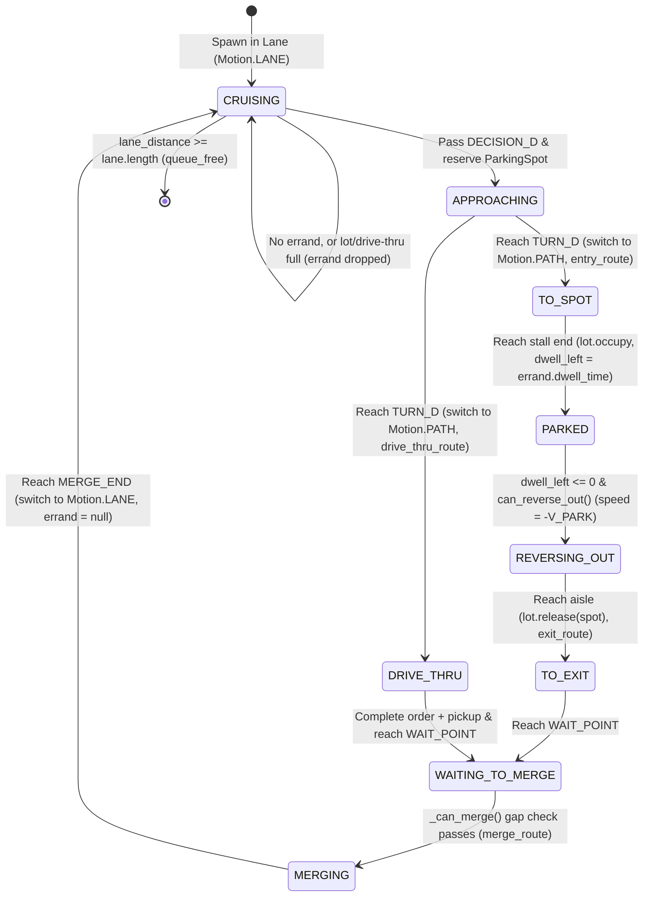

# Traffic, Car, and Navigation Architecture

This document describes how the vehicle, task/errand, and parking navigation systems work in **Stroad Hero**, detailing the simulation model, data mapping to the 3D scene, architectural observations, and recommended improvements.

---

## 1. Simulation Architecture & Navigation Model

Traffic navigation does not use Godot's `NavigationServer3D` or dynamic rigid-body physics. Instead, `TrafficManager` (`traffic/traffic_manager.gd`) drives all vehicle kinematic state parametrically using a dual-mode hybrid model:

```
[Main Stroad] ─── (Motion.LANE: 1D Scalar) ───► [Driveway Turn-In]
                                                         │
                                                         ▼
[Parking Lot / Drive-Thru] ◄─── (Motion.PATH: 3D Bézier Curve3D)
```

1. **Stroad Driving (`Motion.LANE`)**:
   - Cars move along 1D lane coordinates along the X-axis:
     $$x_{\text{world}} = \text{start\_x} + \text{direction} \cdot \text{lane\_distance}$$
     $$z_{\text{world}} = \text{lane\_z}, \quad y_{\text{world}} = 0.05$$
   - Follower vehicles use velocity-dependent safe gaps and comfortable deceleration ($A_{\text{comfort}} = 3.0\text{ m/s}^2$).

2. **Off-Road Navigation (`Motion.PATH`)**:
   - In parking lots and drive-thrus, cars sample parametric 3D cubic Bézier curves generated by `PathBuilder.build()` (`traffic/path_builder.gd`).
   - Curves convert orthogonal waypoints into arcs with fillet radius $r$ ($4.0\text{ m}$) by trimming corner segments by $d = r \tan(\theta/2)$ and adding tangential Bézier handles $h = \frac{4}{3} \tan(\theta/4) r$.
   - Position and yaw derive directly from arc length:
     $$\text{position} = \text{path.sample\_baked}(\text{path\_distance})$$
     $$\text{yaw} = \text{atan2}(-h_z, h_x) \quad \text{where } h = \text{path.sample\_baked}(d + 0.05) - \text{path.sample\_baked}(d - 0.05)$$

---

## 2. Driver Task & Errand Lifecycle



### Key Lifecycle Rules

- **Errand Assignment**:
  - Parkable car types (`SEDAN`, `SUV`, `PICKUP`, `HATCHBACK`, `MINIVAN`, `SPORTS`) spawning on curb lanes (Lanes 0 and 3) have a 30% chance (`P_ERRAND = 0.3`) of receiving an `Errand` (`traffic/errand.gd`).
  - Destinations:
    - **Lane 0 (North / Westbound)**: `walgroins` (dwell 20–45s), `taco_hell` (dwell 15–30s), or `taco_hell_drive_thru`.
    - **Lane 3 (South / Eastbound)**: `booger_king` (drive-thru), `strip_mall` (dwell 20–45s), or `cramped_inn` (dwell 20–45s).
- **Spot Reservation**:
  - At `DECISION_D` (35 m before the driveway), the driver requests a stall from `ParkingLot.request_spot()`.
  - Stalls are scored by:
    $$\text{cost} = \text{distance}(\text{stall}, \text{entrance}) + \text{poach\_penalty} + \text{jitter}$$
    where $\text{poach\_penalty} = 1000\text{ m}$ if parking in an adjacent business's stall on the same apron.
  - If no stall is available, the errand is dropped (`stats["errands_dropped_lot_full"] += 1`) and the car cruises past.
- **Parking & Obstacle Activation**:
  - At the stall, `car.state` becomes `PARKED`, headlamps turn off, and its child `AnimatableBody3D` (`Blocker`) enables collision layer 3 so the player cannot walk through the parked vehicle.
- **Task Clearing vs. Errand Completion**:
  - Expiring `dwell_left <= 0` initiates `REVERSING_OUT`.
  - **`car.errand` is not nulled when parking dwell expires.** It remains attached through `REVERSING_OUT`, `TO_EXIT`, `WAITING_TO_MERGE`, and `MERGING`.
  - `car.errand = null` occurs only after the car completes its merge curve back onto the stroad.
  - `stats["errands_completed"]` increments only when that car (`car.had_errand == true`) reaches the end of its lane and despawns.
- **Seeded Parked Cars**:
  - The 40% of stalls pre-filled at scene startup (`_seed_parked_cars()`) have `errand == null` and `had_errand = false`. They only count down an initial dwell time before exiting into traffic.

---

## 3. Data Structures & Scene Mapping

| Structure            | Source File                      | Description                                                                                                                         | Scene Representation (`main.tscn`)                                                                                      |
| :------------------- | :------------------------------- | :---------------------------------------------------------------------------------------------------------------------------------- | :---------------------------------------------------------------------------------------------------------------------- |
| **`Lane`**           | `traffic/traffic_manager.gd:15`  | Holds 1D boundary scalars, speed limits, spawn timers, and `cars: Array[Car]` sorted by distance.                                   | Represents the 4 stroad lanes along X at $z = \pm 5.6, \pm 1.9$, $y = 0.05$.                                            |
| **`ParkingLot`**     | `traffic/parking_lot.gd:1`       | Node managing stalls, driveway coordinates, entrance vectors, and static route generators.                                          | Child node of `TrafficManager`; coordinates align with visual meshes under `Parking/*`.                                 |
| **`ParkingSpot`**    | `traffic/parking_spot.gd:1`      | `RefCounted` record containing `transform: Transform3D`, `serves: Array[StringName]`, and `state` (`FREE`, `RESERVED`, `OCCUPIED`). | Pure data object. When `PARKED`, `car.global_transform = spot.transform`.                                               |
| **`Errand`**         | `traffic/errand.gd:1`            | `RefCounted` object storing `destination: StringName` and `dwell_time: float`.                                                      | Pure data; resolves to `ParkingLot.ENTRANCES` vectors and lane decision markers.                                        |
| **`Car`**            | `cars/car.gd:1`                  | `Area3D` holding simulation state, visual meshes, and an `AnimatableBody3D` (`Blocker`).                                            | `Area3D` handles moving car-vs-player lethality (`body.die()`); `Blocker` provides stationary solid obstacle collision. |
| **Swept Footprints** | `traffic/traffic_manager.gd:634` | Cached 2D oriented bounding boxes (`PackedVector2Array`) sampled every 0.5 m along a car's lookahead horizon.                       | Tested in XZ plane via 2D Separating Axis Theorem (`_footprints_overlap`) for off-road yielding.                        |

---

## 4. Observations & Bottlenecks

1. **Monolithic Architecture**:
   - `traffic_manager.gd` is ~1,500 lines combining lane spawning, car-following, parking state-machine transitions, 2D SAT geometric math, deadlock detection, debug keybinds (`F4`–`F8`), and telemetry.
2. **Hardcoded Spatial Coupling**:
   - Stall rows, driveway X coordinates, and aisle Z coordinates are hardcoded numeric literals in GDScript rather than referenced from scene markers (`Marker3D`). Editing buildings or parking layouts in `main.tscn` risks silent desynchronization with traffic logic.
3. **North vs. South Asymmetry**:
   - South-side lots use a parameterized dictionary (`SOUTH_LOTS`), whereas the north-side apron (Walgroins / Taco Hell) uses dedicated top-level constants and functions.
4. **Computational Hotspots**:
   - **Stall Route Allocations**: `can_reverse_out()` calls `ParkingLot.reverse_route(car.spot)` every physics tick while a parked car waits for aisle clearance, allocating and baking a new `Curve3D` at 60 Hz.
   - **Mid-Tick Cache Key Allocations**: `_car_sweep()` allocates an 8-element `Array` key on every pair check to catch mid-tick mutations as cars advance sequentially.
   - **Physics Polling**: `Car.advance_simulation()` and `advance_path()` poll `get_overlapping_bodies()` every tick for every moving car, which is redundant with the `body_entered` signal.
   - **Quadratic Lot Conflict Scaling**: Off-road yielding checks every active lot car against all others ($O(N_{\text{lot}}^2)$) and compares nested footprint polygon pairs ($O(S_a \cdot S_b)$).
5. **Profiling Baseline**:
   - Per `docs/improvements.md`, the documented ~3 ms physics step is the **entire native headless physics step**, not an isolated profile of `TrafficManager`. On WebGL builds, main-thread CPU is already near the 16.7 ms frame budget. Profiling with the engine's Debugger Profiler should guide optimization priority.

---

## 5. Architectural Suggestions & Optimization Plan

### Architecture Refactoring

- **Unify Lot Configurations (`LotSite`)**:
  - Consolidate north and south lot definitions into a shared data structure defining `{lane_id, turn_in, entry_x, exit_x, wait, merge_end, entry_aisle, exit_aisle, entrances, merge_route}`.
  - Replaces per-destination `if/elif` chains in `_spawn_car_at()`, `_update_lane_traffic()`, and `_can_merge()`.
- **Extract Conflict Resolution**:
  - Move the 2D swept-footprint solver and deadlock watchdog (`find_blocker`, `_car_sweep`, `_conflict_distance`, `_check_deadlock_watchdog`) out of `TrafficManager` into `traffic/lot_conflict_solver.gd`.
- **Validate Against Scene Markers**:
  - Source stall rows and driveway thresholds from `Marker3D` nodes in `main.tscn` (or validate coordinates at startup in debug builds) to ensure visual layouts and simulation boundaries remain synchronized.

### Performance Optimizations

- **Prebuild and Cache Stall Routes**:
  - Construct and cache `entry_route`, `reverse_route`, and `exit_route` `Curve3D` instances on each `ParkingSpot` inside `ParkingLot._build_spots()`. Eliminates runtime `Curve3D` allocations in `can_reverse_out()`.
- **Lightweight Sweep Cache Invalidation**:
  - Replace the 8-element `Array` allocation in `_car_sweep()` with a lightweight `sweep_rev: int` revision counter on `Car` (incremented on transform/state/speed changes) or compare scalar fields directly on the cached dictionary entry. Retains mid-tick invalidation safety without heap allocations.
- **Streamline Player Collision**:
  - Rely on `body_entered` or a single distance check against the player node instead of polling `get_overlapping_bodies()` across ~25 cars every tick.
- **Spatial Partitioning (if lot count expands)**:
  - Partition `lot_cars` by driveway/apron (north lot vs. south lots) to prevent cars in separate lots from executing pairwise footprint sweep checks.
